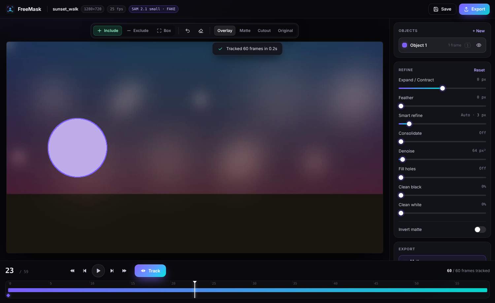

# FreeMask: Magic Mask for the free DaVinci Resolve

FreeMask does the job of Resolve Studio's **Magic Mask** in the **free** version of
DaVinci Resolve. Put the playhead on a clip and choose **Workspace › Scripts › FreeMask**.
Click what you want, press **Track**, then **Export**. The matte and a cutout of your
subject come back into Resolve, lined up on a new track above your clip.



The tracking is done by Meta's **SAM 2.1** (Segment Anything 2), one of the strongest
openly available video segmentation models. It works on people, faces, cars, animals,
products, skies, and almost anything else you can click on.

| Magic Mask                                   | FreeMask                                                       |
|----------------------------------------------|----------------------------------------------------------------|
| Strokes on the subject                       | Click = include, right-click = exclude, drag = box             |
| Track forward / backward / both              | ▶▶ / ◀◀ / **Track** (or `]` `[` `T`)                           |
| Fix a frame where it drifts, re-track        | Click on any frame and track again. Every marked frame is used |
| Multiple masks                               | Objects 1–9, combined into one matte, each one can be hidden   |
| Quality: Faster / Better                     | `--model tiny/small/base/large`, `--quality`                   |
| Smart Refine                                 | Smart refine: snaps the edge to the real image edges           |
| Expand / Contract, Blur                      | Expand / Contract, Feather                                     |
| Consolidate                                  | Consolidate (temporal smoothing)                               |
| Matte finesse: denoise, clean black/white    | Denoise, Fill holes, Clean black, Clean white                  |
| Invert                                       | Invert                                                         |

---

## 1. Install (one time)

You need **Python 3.10 or newer**.
* **Mac:** install it from [python.org](https://www.python.org/downloads/). The `python3`
  that comes with macOS is usually too old.
* **Windows:** install it from python.org and tick **"Add python.exe to PATH"**.

Then:

* **Mac:** double-click **`Install FreeMask (Mac).command`**. If macOS says it can't
  check the developer, right-click the file, choose **Open**, then confirm. Or run
  `bash install_mac_linux.sh` in Terminal.
* **Windows:** double-click **`install_windows.bat`**. If you have an NVIDIA GPU, it uses
  it automatically.
* **Linux:** `bash install_mac_linux.sh`

The installer:
1. creates a private Python environment in `.venv`
2. installs PyTorch and SAM 2
3. downloads the model (~180 MB)
4. adds **FreeMask** to Resolve's **Workspace › Scripts** menu

Restart Resolve if it was open. Keep the FreeMask folder where it is. If you move it,
run the installer again.

## 2. Use it from DaVinci Resolve

1. On the **Edit** or **Cut** page, park the playhead on the clip you want to mask.
2. **Workspace › Scripts › FreeMask.** FreeMask opens on that exact frame, limited to
   the part of the clip that's in your edit.
3. **Click** on the subject. The mask appears instantly. **Right-click** anything that
   got included by mistake, or **drag a box** around the subject.
4. Press **Track** (or `T`). It tracks forwards and backwards while you watch.
5. Scrub the timeline. Where the mask slips, click to correct that frame and track again.
6. Adjust the **Refine** sliders. Switch the view to *Matte* or *Cutout* to judge them.
7. Press **Export**, then **Finish & send to Resolve**.

Back in Resolve you'll find:
* a **FreeMask** bin with the matte (PNG sequence), a matte movie (ProRes) and a cutout
  (PNG sequence with transparency)
* the **cutout placed on a new "FreeMask" track** directly above your clip,
  frame-accurate. Grade the clip underneath and the subject stays untouched, or put
  titles between the two tracks so your subject stands in front of the text.

Run FreeMask again on the same clip and it reopens your previous marks.

### Using the matte on the Colour page

1. In the Media Pool, link the matte to your clip. Depending on your Resolve version,
   right-click the matte and pick its *matte* option, or drag it onto the clip.
2. On the Colour page, right-click in the node editor, choose **Add Matte**, and pick it.
   Connect it to a node's **key input**. That node now only grades your subject. Invert
   the key to grade everything else.

In **Fusion**, drag the matte sequence into the node graph and use it as an effect mask,
or feed it into a **Matte Control** node.

## 3. The app

| | |
|---|---|
| Click / right-click / drag | include point / exclude point / box |
| `I` `X` `B` | include, exclude or box tool |
| `T`, `]`, `[` | track both ways, forward, backward |
| `Esc` | stop tracking |
| `←` `→` (Shift = 10) · `A` `D` | step frames |
| `Space` / `K` | play / pause |
| `Home` / `End` · `N` | first / last frame · next marked frame |
| `1`–`9` | choose object |
| `V` | overlay → matte → cutout → original |
| `C` · `⌘Z` / `Ctrl+Z` | clear this frame's marks · undo |
| `⌘S` · `⌘E` | save session · export |

You can also run it without Resolve: `./freemask.sh` (Mac/Linux) or `freemask.bat`
(Windows) opens the app, and you paste in a clip path. `./freemask.sh clip.mov` opens a
clip directly.

### Speed

Rough estimates; they vary with resolution and how big the subject is:

| Hardware | `small` model, default quality |
|---|---|
| NVIDIA RTX GPU | ~10–25 frames/sec |
| Apple Silicon (M1–M4) | ~2–6 frames/sec |
| CPU only | ~0.5–2 frames/sec. Try `--model tiny --quality 720` |

SAM 2 keeps the shot's frames in memory, roughly 12 MB per frame (a 300-frame shot needs
about 4 GB of RAM). From Resolve, only the part of the clip used in your edit is
processed.

### Headless / batch mode

Coordinates are in source pixels, and frame numbers are source frame numbers:

```bash
./freemask.sh shot.mov --headless --point 120:960,540 --neg 120:1500,300 --format png,video
./freemask.sh shot.mov --headless --box 0:700,200,1250,1080@1 --point 0:300,600@2   # two objects
./freemask.sh shot.mov --headless --session shot_freemask/shot_session.json        # re-run a saved session
```

## Outputs

Everything goes to `<clip>_freemask/` next to the source media:

| | What you get |
|---|---|
| `…_matte/…_matte_000123.png` | 16-bit grayscale matte, white = selected |
| `…_matte.mov` | the same matte as ProRes 422 HQ |
| `…_cutout/…_cutout_000123.png` | your footage with the matte as transparency |
| `…_session.json` | your marks and settings, to resume later |

File numbers are source frame numbers, and mattes are always full resolution.

## Troubleshooting

* **Nothing happens in Resolve.** Open **Workspace › Console**. FreeMask prints what it's
  doing there. The app's own log is `<clip>_freemask/<name>_freemask.log`.
* **Mac App Store version of Resolve:** Apple's sandbox stops it from launching other
  apps, so the menu item can't open FreeMask. Use the free download from
  blackmagicdesign.com instead, or run `./freemask.sh` and paste in the clip path.
* **"Couldn't open video".** FreeMask can't decode Blackmagic RAW or other camera-raw
  formats. Render the shot to ProRes or DNxHR first and use that.
* **It's slow.** Pick a lower quality or the `tiny` model: `--model tiny --quality 720`.
* **Out of memory.** Use a shorter piece of the clip, or a lower quality.

## Honest limitations

* FreeMask is a separate app that Resolve launches. The free Resolve doesn't allow
  plug-ins like Magic Mask inside it, so the matte comes back as media.
* Fine hair and motion blur are good, but not as soft as a dedicated roto artist would
  make them. Use *Smart refine* and *Feather*.

## How it works

```
Resolve script ─► FreeMask app (local, private: http://127.0.0.1 only)
clip ─► frames ─► SAM 2.1 video predictor ◄── your clicks/boxes on any frames
                    └─► tracks forward + backward, remembering every corrected frame
masks ─► despeckle / fill holes ─► consolidate ─► full-res ─► expand/contract
      ─► smart refine (guided filter on the real frame) ─► feather ─► clean ─► invert
      ─► PNG / ProRes / RGBA cutout ─► back into Resolve (bin + track above the clip)
```

## Development

```bash
.venv/bin/pip install pytest playwright lupa
.venv/bin/python -m pytest tests
```

The tests use a stand-in tracker, so they need no model download. They cover:
* the matte maths
* the HTTP API
* the full UI in headless Chromium (clicking, tracking, refining, exporting)
* the Resolve Lua script, run against a simulated Resolve, end to end
* the real SAM 2 code path

`python tests/dev_server.py` runs the UI on a synthetic clip.

SAM 2 is © Meta Platforms, Inc., Apache-2.0 licensed.
